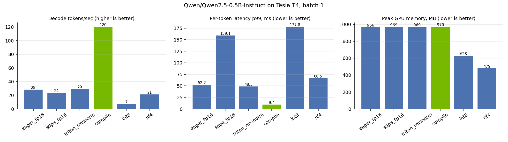

# LLM Inference Optimization Study

How fast can a small language model run on a single NVIDIA GPU, and what does each optimization cost? This project takes `Qwen2.5-0.5B-Instruct` and runs it through every layer of the inference stack, from a hand-written Triton kernel up to a compiled TensorRT engine, measuring latency, tail latency, memory and accuracy with one consistent harness.

Everything runs on a free Google Colab T4 GPU. Open `run_in_colab.ipynb`, pick a T4 runtime, and press Run all.

## Results

<!-- RESULTS:START -->
Model `Qwen/Qwen2.5-0.5B-Instruct` on **Tesla T4**. Prompt 256 tokens, generate 128 tokens, batch 1, greedy, 10 timed runs per variant.

### Key findings

- **torch.compile + static KV cache: 4.2x decode throughput** (28.4 → 120.1 tok/s). Per-token latency fell from 34.1 ms to 8.2 ms, and p99 from 52 ms to 9.4 ms.
- **TensorRT engine: 2.8x faster prefill than PyTorch** (37.8 → 13.6 ms for a 256-token prompt, 1.16x vs torch.compile), with matching outputs (top-1 token match: yes, cosine similarity 0.9999).
- **Custom Triton fused add+RMSNorm kernel: 5.2x faster than eager PyTorch** (median over prefill-sized shapes), 1.02x vs torch.compile, reaching 72% of the GPU's peak memory bandwidth.
- **4-bit NF4 cut peak GPU memory 51%** (969 → 479 MB) at a 10% perplexity cost (15.98 → 17.63).
- **INT8 kept accuracy** (perplexity 16.01 vs 15.98) **but ran 3.9x slower** at batch 1: bitsandbytes LLM.int8 dequantizes weights on every matmul, so at batch 1 that overhead dominates.

### End-to-end generation

| Variant | Decode tok/s | Speedup | TTFT p50 (ms) | Per-token p50 (ms) | Per-token p99 (ms) | Peak memory (MB) | WikiText-2 perplexity |
|---|---:|---:|---:|---:|---:|---:|---:|
| `eager_fp16` | 28.4 | 1.00x | 39.7 | 34.09 | 52.16 | 966 | 15.980 |
| `sdpa_fp16` | 23.8 | 0.84x | 42.7 | 34.92 | 159.10 | 969 | 15.980 |
| `triton_rmsnorm` | 29.2 | 1.03x | 40.5 | 33.18 | 48.53 | 969 | 15.980 |
| `compile` | 120.1 | 4.23x | 46.7 | 8.16 | 9.43 | 970 | 15.980 |
| `int8` | 7.3 | 0.26x | 164.8 | 135.01 | 177.76 | 628 | 16.012 |
| `nf4` | 21.1 | 0.74x | 62.3 | 45.95 | 66.51 | 479 | 17.629 |



### TensorRT prefill (256-token prompt, TensorRT 11.4.0.106)

| Backend | p50 (ms) | p99 (ms) | Speedup |
|---|---:|---:|---:|
| PyTorch eager (SDPA) | 37.78 | 60.08 | 1.00x |
| torch.compile | 15.70 | 29.38 | 2.41x |
| TensorRT engine | 13.56 | 14.08 | 2.79x |

Output check vs PyTorch: top-1 token match **yes**, top-5 overlap 5/5, cosine similarity 0.99988. Engine build: 21 s, 4682 network layers.

### Triton kernel microbenchmark (Tesla T4, peak 320 GB/s)

M = rows (1 = one decode token, 4096 = long prefill), N = hidden size.

| M | N | Eager PyTorch (µs) | torch.compile (µs) | Triton (µs) | vs eager | vs compile | GB/s | % of peak |
|---:|---:|---:|---:|---:|---:|---:|---:|---:|
| 1 | 896 | 76.4 | 8.9 | 5.2 | 14.60x | 1.70x | 2 | 1% |
| 32 | 896 | 54.5 | 5.7 | 5.3 | 10.18x | 1.06x | 43 | 14% |
| 512 | 896 | 57.5 | 19.9 | 19.5 | 2.95x | 1.02x | 188 | 59% |
| 4096 | 896 | 684.2 | 128.0 | 153.1 | 4.47x | 0.84x | 192 | 60% |
| 1 | 2048 | 49.0 | 6.8 | 5.1 | 9.59x | 1.34x | 4 | 1% |
| 32 | 2048 | 85.0 | 8.6 | 7.6 | 11.16x | 1.13x | 69 | 22% |
| 512 | 2048 | 198.1 | 40.9 | 49.3 | 4.02x | 0.83x | 170 | 53% |
| 4096 | 2048 | 1524.5 | 297.3 | 292.8 | 5.21x | 1.02x | 229 | 72% |
| 1 | 4096 | 27.6 | 9.3 | 19.7 | 1.40x | 0.47x | 2 | 1% |
| 32 | 4096 | 38.4 | 10.9 | 8.4 | 4.60x | 1.30x | 126 | 40% |
| 512 | 4096 | 391.8 | 80.8 | 75.5 | 5.19x | 1.07x | 222 | 69% |
| 4096 | 4096 | 3021.6 | 599.6 | 585.2 | 5.16x | 1.02x | 229 | 72% |
<!-- RESULTS:END -->

## What was tested

| Variant | Technique | Question it answers |
|---|---|---|
| `eager_fp16` | PyTorch eager, naive attention | Baseline |
| `sdpa_fp16` | Fused scaled-dot-product attention | How much does a fused attention kernel help at batch 1? |
| `triton_rmsnorm` | Custom Triton RMSNorm kernel patched into all 49 norm layers | Does a faster kernel speed up the whole model? |
| `compile` | Static KV cache + `torch.compile` (TorchInductor) | How much time is framework and launch overhead? |
| `int8` | 8-bit weights (bitsandbytes LLM.int8) | Memory saved vs speed and accuracy lost |
| `nf4` | 4-bit NF4 weights (bitsandbytes) | Same question, more aggressive |
| TensorRT | ONNX export → strongly typed TensorRT engine | What does NVIDIA's inference compiler add for prefill? |

## Analysis

**Small-model decoding is overhead-bound, not compute-bound.** A 0.5B model generating one token at a time launches hundreds of tiny GPU kernels per token, and the Python and launch overhead between them takes longer than the math inside them. The profiler trace (`profile_decode.py`) shows the GPU sitting idle between kernels. That's why the static KV cache plus `torch.compile` gives the largest win by far: fixed tensor shapes let Inductor fuse operations and cut per-token framework work.

**A faster kernel doesn't always mean a faster model.** The Triton RMSNorm kernel is several times faster than eager PyTorch in isolation and runs close to the memory-bandwidth limit for prefill-sized inputs, yet swapping it into the model barely changes end-to-end decode speed. RMSNorm is a small slice of total time, and at batch 1 the overhead above dominates. Profile first, then optimize where the time actually goes.

**The kernel is memory-bound by design.** RMSNorm does a handful of operations per element, so its speed limit is DRAM bandwidth. The unfused PyTorch version reads and writes the hidden state about six times; the Triton kernel fuses the residual add, the reduction and the scaling into one pass. At one row (decode) it can't saturate bandwidth: there's too little work to hide launch latency, which is the same overhead story as above.

**Quantization saves memory, not necessarily time.** 4-bit NF4 halves memory with a measurable accuracy cost. INT8 keeps accuracy but is much slower at batch 1, because bitsandbytes dequantizes weights on every matmul. On memory-limited devices like Jetson-class edge GPUs the memory savings can be the point; for latency, they need kernels that compute directly on quantized weights.

**TensorRT targets the whole graph.** Exporting the prefill pass to ONNX and building a strongly typed engine lets TensorRT pick kernels and fuse layers for this specific GPU and shape, while keeping the FP32 accumulation the model asks for. The engine's outputs are checked against PyTorch (top-1 token, top-5 overlap, cosine similarity) so the speedup isn't hiding a correctness bug.

## Methodology

- **Same work for every variant:** batch 1, fixed 256-token prompt, exactly 128 greedy tokens (`min_new_tokens = max_new_tokens`).
- **True per-token latency:** a streamer synchronizes the GPU and timestamps every generated token, so p50 and p99 come from real per-token measurements, not from averaging total time.
- **Warmup before timing**, with extra warmup for compiled variants so compilation never lands in the measurements.
- **Process isolation:** each variant runs in its own process, so a crash or leftover memory in one backend can't affect another.
- **Accuracy is measured, not assumed:** WikiText-2 perplexity for every weight format; output comparison for TensorRT; `torch.testing.assert_close` against a PyTorch reference for the Triton kernel at every benchmarked shape.
- **Kernel timing** uses `triton.testing.do_bench` after explicit warmup of every path; bandwidth counts the minimum bytes the op must move.

## Project layout

| File | Purpose |
|---|---|
| `kernels/rmsnorm_triton.py` | Fused residual-add + RMSNorm Triton kernel, model patching, correctness test, microbenchmark |
| `bench.py` | End-to-end latency harness (TTFT, per-token p50/p99, tokens/sec, peak memory) |
| `trt_prefill.py` | ONNX export, TensorRT engine build, prefill benchmark and output check |
| `perplexity.py` | WikiText-2 perplexity per variant |
| `profile_decode.py` | PyTorch profiler: top GPU kernels plus a Chrome trace of 32 decode steps |
| `report.py` | Builds the tables, chart and this README's results section |
| `common.py` | Model loading for every variant |
| `run_in_colab.ipynb` | Runs everything end to end on Colab |

## Reproduce

On Colab: upload `run_in_colab.ipynb`, select Runtime → Change runtime type → T4 GPU, then Runtime → Run all (about 30 minutes).

On any machine with an NVIDIA GPU:

```bash
pip install -r requirements.txt
python -m kernels.rmsnorm_triton    # kernel correctness + microbenchmark
python bench.py                     # end-to-end latency, all variants
pip install tensorrt                # only needed for the next step
python trt_prefill.py               # TensorRT engine
python perplexity.py                # accuracy
python profile_decode.py --variant compile
python report.py                    # tables, chart, README
```

Use `--model TinyLlama/TinyLlama-1.1B-Chat-v1.0` (or any Llama/Qwen-style model) to run a larger model.

## Limitations

- One GPU (T4) and one small model; the balance between overhead and compute shifts on larger models and faster GPUs.
- Batch 1 only, which is the latency-focused case. Throughput at larger batch sizes behaves differently, especially for quantized formats.
- The TensorRT comparison covers prefill with a fixed prompt length. Full TensorRT generation with a KV cache is the job of TensorRT-LLM.

## License

MIT
